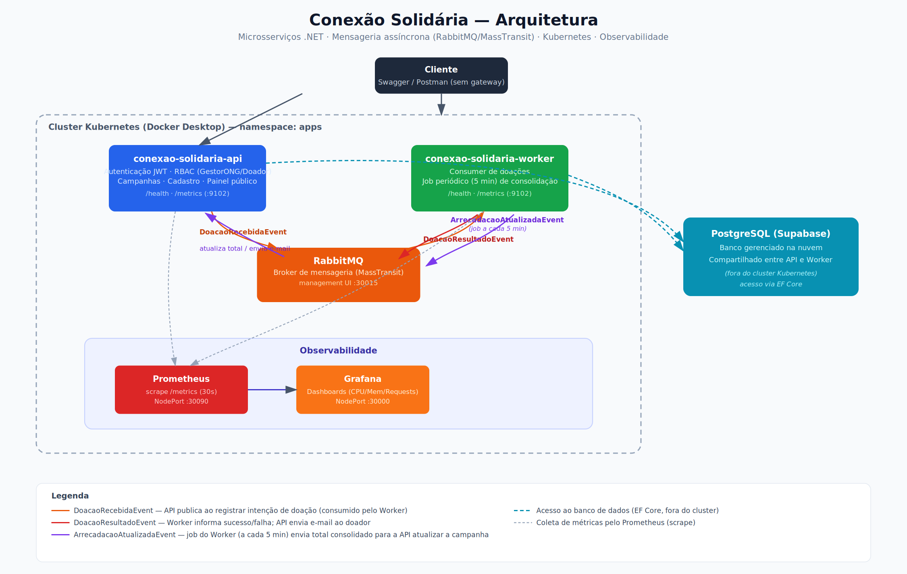

# Conexão Solidária — API Principal

API desenvolvida para o Hackathon Conexão Solidária. Responsável pelo gerenciamento de usuários (ONGS e Doadores), criação de campanhas e registro das intenções de doação.

## Tecnologias Utilizadas
* .NET (C#)
* Entity Framework Core
* PostgreSQL
* RabbitMQ & MassTransit (Mensageria assíncrona)
* Docker & Docker Compose
* Kubernetes (Docker Desktop)
* Prometheus & Grafana (Observabilidade)

## Pré-requisitos
* Docker Desktop instalado e rodando, com o Kubernetes habilitado.
* SDK do .NET instalado.
* `kubectl` configurado apontando para o cluster local do Docker Desktop.

---

## Como rodar o Banco de Dados e RabbitMQ

Existem duas formas de subir a infraestrutura: via **Docker Compose** (mais simples, para desenvolvimento do dia a dia) ou via **Kubernetes** (ambiente que replica a arquitetura final do projeto). Escolha uma delas e configure o `Host` de acordo com a tabela abaixo.

### Opção A — Docker Compose

1. Na raiz do projeto, crie um arquivo chamado `.env`.
2. Adicione a seguinte linha dentro do arquivo, definindo a senha do banco:
   `POSTGRES_PASSWORD=sua_senha_aqui`
3. Suba os containers do PostgreSQL e RabbitMQ:
   `docker compose up -d`

### Opção B — Kubernetes

Veja a seção [Executando via Kubernetes](#-executando-via-kubernetes) mais abaixo.

---

## Como configurar a API (Ambiente Local)

Este projeto **não utiliza o .NET Secret Manager**. As configurações de conexão, JWT e barramento são feitas via `appsettings.Development.json`.

1. Entre na pasta da API:
   `cd ConexaoSolidaria.API`

2. Crie (ou edite) o arquivo `appsettings.Development.json` com o seguinte conteúdo:

```json
{
  "ConnectionStrings": {
    "CONEXAO_SOLIDARIA": "Host=;Port=;Database=conexaosolidaria;Username=postgres;Password=sua_senha_aqui"
  },
  "Jwt": {
    "Key": "uma_chave_segura_de_pelo_menos_256_bits_aqui"
  },
  "Bus": {
    "Host": "localhost",
    "Port": "5672",
    "User": "guest",
    "Password": "guest"
  }
}
```

3. **Atenção ao valor de `Bus:Host`**, ele muda dependendo de como você subiu a infraestrutura:

| Ambiente | Valor de `Bus:Host` |
|---|---|
| Docker Compose | `localhost` |
| Kubernetes (Docker Desktop) | `host.docker.internal` |

4. Localmente, a porta do RabbitMQ é sempre `5672`, com usuário e senha `guest`.

5. Crie as tabelas no banco de dados aplicando as migrações:
   `dotnet ef database update`

6. Rode o projeto:
   `dotnet run`

---

## ☸️ Executando via Kubernetes

O projeto também pode ser executado inteiramente dentro do cluster Kubernetes local (Docker Desktop).

### Passo 1: Configurar os Secrets

O arquivo `k8s/secrets.yaml` é versionado apenas como template, com os campos sensíveis em branco:

```yaml
apiVersion: v1
kind: Secret
metadata:
  name: conexao-solidaria-secrets
  namespace: apps
type: Opaque
stringData:
  ConnectionStrings__CONEXAO_SOLIDARIA: ""
  Bus__Password: ""
  Jwt__Key: ""
```

Antes de aplicar os manifests, preencha localmente:
- `ConnectionStrings__CONEXAO_SOLIDARIA`: string de conexão do PostgreSQL (Supabase ou local).
- `Jwt__Key`: chave segura de pelo menos 256 bits para assinatura dos tokens JWT.

> ⚠️ Nunca faça commit deste arquivo com valores preenchidos.

### Passo 2: Gerar a imagem Docker da API

```bash
docker build -t conexao-solidaria-api:latest .
```

> ⚠️ O nome da imagem precisa ser exatamente `conexao-solidaria-api:latest`, pois é essa referência que os manifests do Kubernetes utilizam. Sem isso, o pod não sobe corretamente.

### Passo 3: Aplicar os manifests do Kubernetes

Acesse a pasta de manifests da API:
```bash
cd ConexaoSolidaria.API/k8s
```

Primeiro, crie o namespace:
```bash
kubectl apply -f namespace.yaml
```

Depois, aplique o restante dos manifests (Deployments, Services, ConfigMaps, Secrets):
```bash
kubectl apply -f .
```

### Passo 4: Verificar se o pod subiu corretamente

```bash
kubectl get pods -n apps
```

O pod da API deve aparecer com status `Running`.

> 💡 Lembre-se: como o cluster é local (Docker Desktop), a API rodando dentro de um pod precisa se conectar ao RabbitMQ e ao Postgres usando `host.docker.internal` como Host, e não `localhost` — conforme indicado na tabela acima.

---

## 🔄 CI/CD

O pipeline está em `.github/workflows/ci.yml` e é executado automaticamente a cada push na branch `main`. Ele realiza, nesta ordem:
1. Restore, build e execução dos testes unitários (xUnit) do projeto.
2. Build e push da imagem Docker da API (`conexao-solidaria-api`) para o Docker Hub, com as tags `latest` e o SHA do commit.

---

## 📊 Observabilidade

A API expõe métricas no endpoint `/metrics` e health checks em `/health` (usado pelas probes do Kubernetes), consumidos pelo Prometheus e visualizados no Grafana.

### Local (Docker Compose)

Crie um arquivo `prometheus.yml` na raiz do projeto (mesmo diretório do `docker-compose.yml`) com o seguinte conteúdo:

```yaml
scrape_configs:
  - job_name: 'conexao-solidaria-api'
    tls_config:
        insecure_skip_verify: true
    static_configs:
      - targets: ['host.docker.internal:5155']
    metrics_path: '/metrics'
    scrape_interval: 15s
```

> A porta `5155` corresponde à porta HTTP local da API (perfil `http` do `launchSettings.json`). Ajuste caso sua porta local seja diferente.

Suba a infraestrutura com `docker compose up -d` e acesse:
- **Prometheus:** http://localhost:9090
- **Grafana:** http://localhost:3000 (login padrão: `admin` / `admin`)

No Grafana, adicione o Prometheus como datasource (`http://prometheus:9090`) e crie um dashboard com as métricas desejadas (ex.: contagem de requisições HTTP, uso de CPU/memória).

### Kubernetes

Com o cluster no ar (`kubectl apply -f .` dentro da pasta `k8s/`), acesse:
- **Prometheus:** http://localhost:30090
- **Grafana:** http://localhost:30000 (login: `admin` / `admin`, já configurado via variáveis de ambiente no deployment)

O Grafana já sobe com o Prometheus (`http://prometheus-service:9090`) pré-configurado como datasource. **O dashboard precisa ser importado/criado manualmente** na primeira execução — não há provisionamento automático de dashboards neste momento.

Internamente, o Prometheus coleta as métricas da API através do Service `metrics` (porta `9102`), que redireciona para a porta `8080` do pod, onde o endpoint `/metrics` está exposto.

---

## 🐰 RabbitMQ Management

Para acompanhar visualmente os eventos (`DoacaoRecebidaEvent`) passando pela fila:

- **Docker Compose:** http://localhost:15672
- **Kubernetes:** http://localhost:30015

Login padrão em ambos os ambientes: `guest` / `guest`.

---

## Como rodar os Testes Unitários

Para rodar a suíte de testes unitários xUnit da aplicação a partir da raiz:
```bash
dotnet test ConexaoSolidaria.slnx
```

## Como Testar os Endpoints

Você pode testar todos os fluxos da API (cadastro público, login de múltiplos perfis, campanhas e doações seguras via fila) abrindo o arquivo [ConexaoSolidaria.API.http](./ConexaoSolidaria.API/ConexaoSolidaria.API.http) no editor e enviando as requisições na ordem indicada.

## 🔄 Integração com o Worker (Multi-Repositório)

Este projeto foi construído utilizando uma arquitetura orientada a eventos para garantir alta escalabilidade no processamento de doações. A solução está dividida em dois repositórios distintos:
1. **API Principal (`application` — este repositório)**: Responsável pelas regras de negócio da API, persistência das campanhas, autenticação e publicação dos eventos de doação no RabbitMQ.
2. **Worker (`worker` — repositório irmão)**: Um serviço de background que consome as mensagens de doação da fila no RabbitMQ, computa e atualiza o saldo e progresso financeiro das campanhas no mesmo banco de dados PostgreSQL.

### Fluxo completo:


